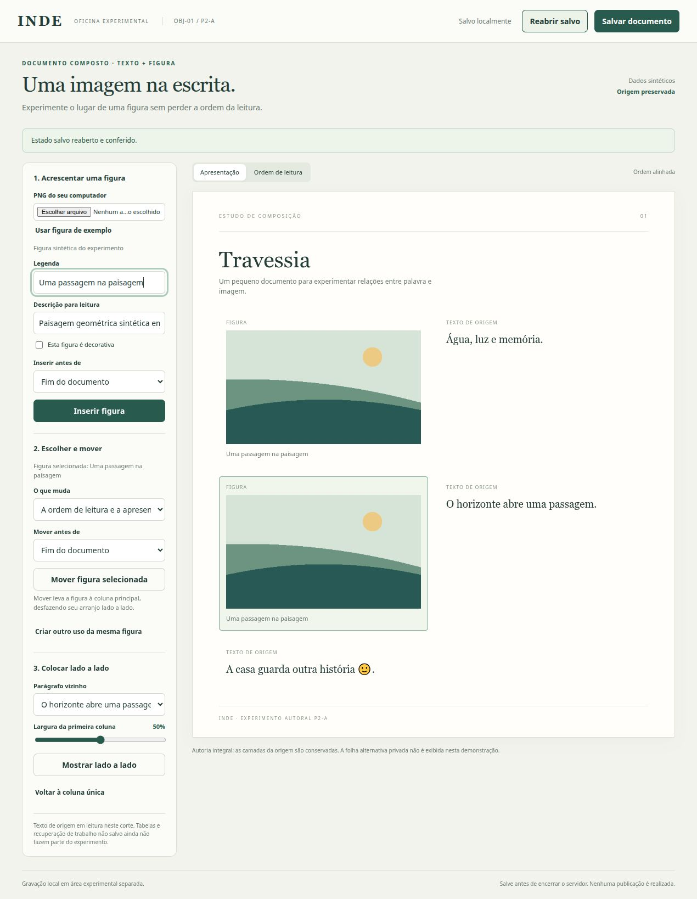

# OBJ-01 — Validação do corte P2-A

Data: 2026-11-21. Base `42a623311db44017634b1504a2b34c0e8bf3da25`; implementação `f3edd18`, branch `feature/inde-obj-01-foundation`. Escopo autorizado: primeiro experimento de texto/PNG, interface local sem GTK, banco auxiliar de dados sintéticos, testes/CI e parada em P2-A.

## Resultado observável

A demonstração usa núcleo C++ e SQLite reais. Importa PNG, insere entre grupos textuais, apresenta figura/parágrafo lado a lado, compartilha recurso entre usos independentes e separa ordem autoral de apresentação. Save/reabertura conservam bytes, IDs, legendas, proporções e seleção. A origem permanece congelada.

Ver [arquitetura e decisões](../arquitetura/P2A-DOCUMENTO-COMPOSTO-OBJ-01.md), [roteiro de abertura](../../tools/obj01-pilot/README.md) e [evidência estruturada](evidencias-obj01-p2a/resultados.json). O aceite humano e a conclusão da Fase 2 inteira permanecem separados.

## Casos do contrato

| Caso | Situação técnica neste corte | Evidência / limite |
| --- | --- | --- |
| P01 | Comprovado no perfil P2-A | Snapshot de Documento proprietário com Unicode/camadas; comparação byte a byte da origem após cada teste. Não cria projeto SQLite schema 37 completo |
| P02 | Comprovado no núcleo/controlador e no percurso de exemplo do navegador | PNG real, bytes/hash/dimensões, IDs distintos, descrição declarada e imagem decodificada/visível; automação do seletor de arquivo ficou inconclusiva |
| P03 | Comprovado | Inserção entre grupos; tentativa no interior da resma recusada sem substituir estado |
| P04 | Comprovado no viewport observado | Dois Rows, cada qual com colunas de 381 px e gap de 20 px; PNG carregado 480 × 280. Frações/gap também testados por roundtrip preciso |
| P05 | Comprovado | Dois usos do mesmo objeto/recurso; só um move; outro uso e bytes iguais; diferença autoral/visual observada e testada |
| P09 | Parcial, texto/PNG/perfis | Novo processo reabre sem PNG externo; SQLite integrity_check ok e blobs iguais; não há tabela/células |
| P11/P12 | Parcial, perfil P2-A | Grupo protegido, revisão stale/CAS, PNG inválido/CRC/APNG/excesso, blob ausente/corrupto, versão desconhecida, rollback de falha SQLite |
| P06–P08/P10/P13/P14 | Pendentes no escopo completo | Tabela, remoção/undo do agregado, reordenação textual, trabalho recuperável e contexto/publicação completos não entregues |

P08 não é aprovado por haver movimentação de figura: falta remoção/undo/redo. P13 não é aprovado por haver save. As abas de apresentação/leitura não são todo o contexto Texto/Estrutura/Composição de P14.

## Testes executados

- **19 testes do processo C++ real**, por fixtures temporárias exclusivas: captura privada, PNG/identidades, ordens, grupos, Row, usos compartilhados, save/reabertura por processo novo, precisão decimal, revisão stale, conflito CAS, aborto SQLite com rollback, blob ausente/corrupto, versões e lease.
- **Quatro testes HTTP reais**, do controlador ao processo C++ e SQLite: guardas de acesso/origem, arquivos da interface/cabeçalhos, importação/save/reabertura/recurso e requisições inválidas sem efeito.
- **Nove grupos da ponte documental existente**, incluindo 250 ordens geradas e limite de 10.000 parágrafos, executados no mesmo alvo isolado.
- Cada uma das quatro compilações locais — GCC 15.2 e Clang 18.1, com/sem ASan+UBSan — aprovou os três programas de teste acima. Os testes HTTP foram executados separadamente por precisarem da permissão do ambiente para loopback. Localmente, LeakSanitizer ficou desativado; a CI usa `detect_leaks=1`.
- **Suíte nativa Release: 61/61 programas aprovados**, em 183,96 s, após recompilação do alvo existente.
- **Três arquivos compactados reextraídos em pasta temporária exclusiva**, com hash dos pacotes, manifesto e bytes extraídos conferidos; cinco testes do verificador também aprovados. As fontes protegidas não foram editadas.

Os logs individuais, [fontes.json](evidencias-obj01-p2a/fontes.json), [geometria observada](evidencias-obj01-p2a/navegador-geometria.json) e [estado final acessível](evidencias-obj01-p2a/navegador-final.txt) estão acompanhados do [manifesto SHA-256](evidencias-obj01-p2a/SHA256SUMS). Conferir a partir da raiz da worktree: `sha256sum -c docs/validacao/evidencias-obj01-p2a/SHA256SUMS`.

A conferência documental resolveu 90 referências locais. Os 11 itens do manifesto histórico da reconciliação também foram conferidos **nos bytes do commit `42a6233`**. Manifestos que incluem documentação mutável devem ser aplicados à revisão que os registrou; não se reescreve a evidência antiga para fazê-la coincidir com documentos legitimamente atualizados por P2-A.

A CI ampliada acrescentou quatro jobs P2-A (GCC/Clang × sanitização ligada/desligada) aos 21 existentes. **25/25 jobs aprovados**, incluindo LeakSanitizer remoto, no commit `f3edd18d2fd448c81dd7fd5ef3dd8c338dafe958`: [execução 44917901238](https://github.com/Roger-Cardoso/inde/actions/runs/44917901238), [resultado bruto](evidencias-obj01-p2a/ci.json). Não se atribui esse passe a um commit posterior por inferência; a consolidação documental recebe sua própria execução.

## Verificação no navegador e lacuna real

Foram observados: abertura da captura, importação pelo botão de PNG sintético, inserção entre grupos, figura/parágrafo lado a lado, gravação e reabertura, segundo uso do mesmo recurso, movimentação de apenas um uso, apresentação divergente da leitura e recusa de operação autoral até restauração explícita. Seleção por Enter conservou o foco. Legenda com sintaxe HTML apareceu literalmente e não criou o elemento solicitado pelo texto.

Depois de encerrar o primeiro servidor com o documento salvo, a fixture sintética fechada foi copiada para `dados/obj01-piloto-p2a/` e aberta por outro processo com o binário final. O estado salvo reaberto mostrou os dois usos e os recursos disponíveis. A demonstração final foi novamente salva/reaberta, com dois Rows e imagens carregadas, e capturada para revisão.

**Lacuna:** o teste do seletor nativo de arquivo pela automação do navegador foi interrompido pelo ambiente; não se confirmou esse percurso visual. O controle está implementado, e bytes de arquivo real são exercitados no processo/HTTP, inclusive reabertura após remover o PNG externo, mas isso não substitui o passe humano desse seletor. Não houve impedimento de loopback após a permissão de execução local; a primeira tentativa restrita de bind foi registrada como limitação do ambiente, não falha funcional do piloto.

## Preservação, limites e parada

A `main` original permanece em `d41a5c9b9809ca7d40beb6ff10f22f1a5b451e0b`, com a alteração preexistente de permissão de `Preparar-ponte.sh` conservada. Não houve migração, merge, publicação autoral, escrita em obra real, edição de fontes compactadas ou integração GTK. CMake do aplicativo, codecs proprietários e comandos existentes foram preservados; o alvo novo é separado.

O Documento sintético é real para seus codecs, mas não representa a abertura de um projeto SQLite schema 37 completo. O texto de origem é somente leitura na interface; formatação completa não é renderizada. Não há tabela, equação, remoção, undo/redo composto ou recuperação de trabalho não salvo. Encerrar o processo perde alterações que ficaram só em memória. Não foram provadas falha de energia, todas as falhas de sistema, larga concorrência, desempenho/RSS ou todos os tamanhos de tela.

P2-A termina nesta entrega utilizável e suas evidências. Revisão/aceite humano permanecem pendentes; P2-B depende de escopo e autorização expressos, sem continuação automática.
