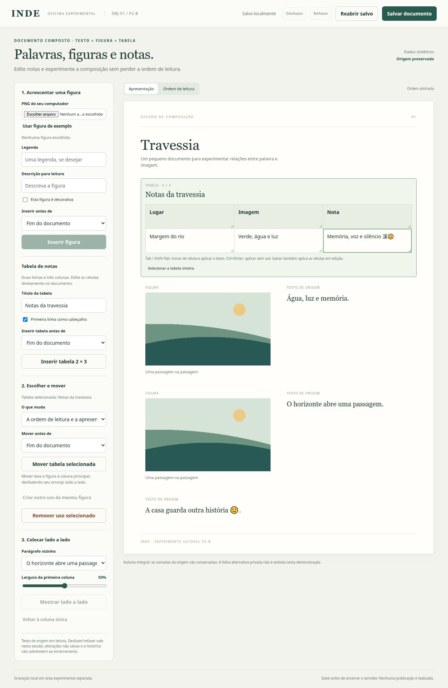

# OBJ-01 — Validação de P2-B

Data: 2026-11-21. Base `8ea6c23`; implementação `ee8e297`, correção de destino inicial `e0aa9af`. Branch `feature/inde-obj-01-foundation`. Escopo: tabela estruturada no piloto, edição por célula, teclado, movimento/remoção e histórico vivo, persistência/compatibilidade, regressões e demonstração local.

Ver [arquitetura](../arquitetura/P2B-DOCUMENTO-COMPOSTO-OBJ-01.md), [roteiro de abertura](../../tools/obj01-pilot/P2B.md) e [resultados estruturados](evidencias-obj01-p2b/resultados.json).

## Evidência funcional

| Caso | Resultado técnico |
| --- | --- |
| P06 | Tabela 2 × 3 com IDs distintos de objeto/uso/linhas/colunas/células; edição muda somente o alvo e a revisão correspondente; UTF-8 e limites verificados |
| P07 | Seleção tipada e navegação Tab/Shift+Tab confirmadas no navegador; foco não aciona movimento; ordem deriva de IDs, e não do índice de vista |
| P08 | Mover/remover/desfazer/refazer tabela; remover último uso de figura, salvar e restaurar; conteúdo, IDs, recursos, Row e seleção conservados; revisão monotônica e histórico limitado |
| P09 | Texto, PNG, células, sequências, perfis e seleção reabrem por processo novo; histórico reinicia; recurso não depende do PNG externo |
| Compatibilidade | P2-A conserva formato e seus testes; cópia P2-A → P2-B lê origem sem escrita e preserva identidades/bytes; modo errado recusa abertura sem migrar |
| Recusas | Célula inexistente, colisão de IDs, texto excedido/UTF-8 inválido, divisão de grupo, revisão stale e remoção de parágrafo conservam o estado |

## Verificações executadas

- P2-A: 19 testes do processo e quatro HTTP reais, preservados como regressão.
- P2-B: 12 testes do processo e seis HTTP reais, incluindo os quatro percursos comuns do controlador e duas provas específicas de tabela.
- Nove grupos da ponte documental existente, incluindo 250 ordens geradas e limite de 10.000 parágrafos.
- Cinco programas de teste aprovados em cada variante GCC/Clang, com e sem ASan+UBSan. LeakSanitizer local desativado; a matriz remota o executa.
- Suíte nativa Release: **61/61 programas aprovados**, em 211,13 s. Três pacotes de fontes reextraídos em pasta temporária exclusiva, com hashes, manifestos e bytes extraídos conferidos.
- Verificação de hashes da fixture P2-A antes/depois da cópia e da demonstração; `main`/fontes/metadata protegidas conferidas separadamente.

**25/25 jobs aprovados**, com LeakSanitizer remoto, no commit `e0aa9af0269f3be1193006a94192b47cf5d872b8`: [execução 44923389940](https://github.com/Roger-Cardoso/inde/actions/runs/44923389940), [resultado bruto](evidencias-obj01-p2b/ci.json). O commit de consolidação documental recebe sua própria CI; não se transfere um passe entre commits por inferência.

## Navegador e reabertura

A demo foi criada em `dados/obj01-piloto-p2b/`, a partir do estado salvo de P2-A. Foram editadas as três células da segunda linha, com Unicode; Tab e Shift+Tab mantiveram o alvo esperado. Save aplicou uma célula ainda em edição. Undo/redo restaurou o conteúdo; movimento, remoção e undo da tabela conservaram suas seis células.

O primeiro servidor P2-B foi encerrado com o documento salvo. Outro processo, com o binário final, reabriu a mesma pasta. A tabela, seus IDs, textos, duas ocorrências de figura, dois Rows e a célula selecionada foram conservados; Desfazer/Refazer apareceram indisponíveis, conforme o limite de reinício. O [registro de células](evidencias-obj01-p2b/navegador-celulas.json) e o [estado acessível final](evidencias-obj01-p2b/navegador-final.txt) acompanham a captura.

A lacuna visual do seletor de PNG registrada em P2-A não foi promovida a passe neste corte. A demonstração de tabela utiliza os bytes já incorporados, com importação/recursos cobertos pelos testes existentes.

## Preservação e limites

Nenhuma obra autoral foi aberta ou modificada. A cópia de P2-A usa conexão somente leitura; seu banco e origem permanecem byte a byte iguais à conferência inicial. O perfil antigo não é atualizado automaticamente. `main`, formatos reais, fontes compactadas, CMake do aplicativo e códigos proprietários permanecem preservados. Não houve merge, migração, publicação autoral, GTK ou arquivo único `.inde`.

Não há edição de linhas/colunas, fórmulas, mesclagens, rich text, usos compartilhados de tabela ou edição dos parágrafos. O histórico é limitado, fica em memória e pode perder entradas antigas conforme orçamento/validade. Recursos removidos permanecem na biblioteca; não há exclusão definitiva ou coleta automática. Alterações não salvas e histórico não sobrevivem ao encerramento. Falha de energia, todos os erros de sistema, ampla concorrência, RSS/latência e todos os viewports não foram demonstrados.

A orientação atual do usuário permite continuidade pelo planejamento discutido sem confirmação ritual de cada corte. Isso não altera os limites de preservação nem substitui aceite humano. O próximo marco técnico continua P2-C: trabalho composto recuperável e fechamento dos casos ainda pendentes.

## Conferência dos artefatos

O [manifesto SHA-256](evidencias-obj01-p2b/SHA256SUMS) usa caminhos relativos à raiz da worktree: `sha256sum -c docs/validacao/evidencias-obj01-p2b/SHA256SUMS`. Manifestos históricos que incluem código/documentação mutáveis devem ser conferidos na revisão que os registrou; os 37 itens de P2-A foram conferidos nos bytes de `8ea6c23`, sem reescrever sua evidência.
