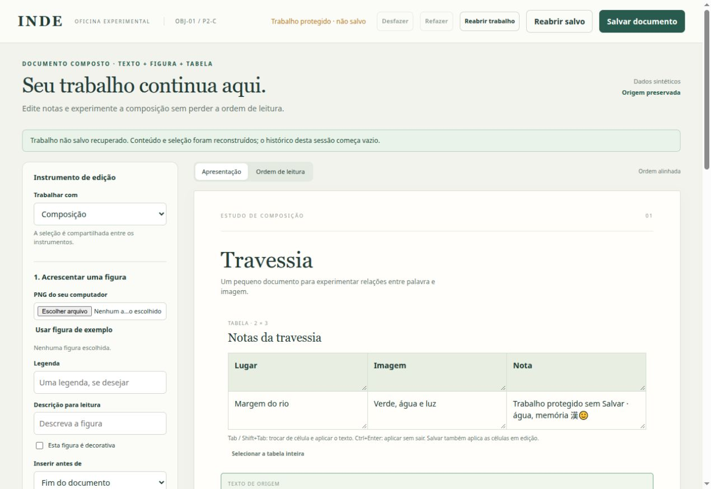

# OBJ-01 — Validação de P2-C

Data: 2026-11-21. Base `b1ae38f`; implementação `b637d0bfcdc82437902fbc786549541ad68267fe`. Branch `feature/inde-obj-01-foundation`. Escopo: registro recuperável do agregado, reordenação integral por motor proprietário, instrumentos mínimos e fronteira explícita de recusa da publicação no piloto.

Ver [arquitetura e matriz de riscos](../arquitetura/P2C-DOCUMENTO-COMPOSTO-OBJ-01.md), [abrir a demo](../../tools/obj01-pilot/P2C.md) e [resultados estruturados](evidencias-obj01-p2c/resultados.json).



## Resultado funcional e lacunas

| Caso | Resultado e alcance |
| --- | --- |
| P01–P09 | Regressões P2-A/B conservadas: texto/PNG/tabela, identidade, recursos, Rows, células, teclado, movimento/remoção, histórico vivo e reabertura salva. P2-C reutiliza esse agregado; o seletor nativo de PNG continua sem passe visual completo |
| P10 | Grupo textual completo muda na sequência composta e no snapshot proprietário pelo `move_reading_block` real; undo/redo e reinício conservam IDs e camadas. A origem congelada não muda |
| P11 | Grupo parcial e intervalo incompatível recusados antes da gravação; teste sintético com âncora atravessando grupos e conservação do estado |
| P12 | Novas provas de base/geração stale, corrupção de trabalho/blob, rollback e confirmação perdida; continuam as recusas de formato, revisão e PNG dos perfis anteriores |
| P13 | SIGKILL após trabalho composto confirmado recupera fonte de trabalho, tabela/células, PNG/Row, ordens, seleção e contexto. Estado salvo permanece anterior. Undo confirmado também é recuperado; histórico reinicia |
| P14 | Texto/Estrutura/Composição mantêm alvo por identidade e guardas no núcleo. Folha privada não aparece na vista. Publicação é recusada explicitamente na fronteira do piloto. **Integração com o publicador principal pendente** |
| Aceite humano | A demonstração foi exercitada e observada tecnicamente; aceite do usuário ainda é um registro separado |

P2-C não é declaração de conclusão integral da Fase 2 ou autorização para Fase 3. A matriz acima identifica a lacuna concreta de P14, além dos limites da interface já conhecidos.

## Testes e CI

- P2-A: 19 testes do processo C++ e quatro percursos HTTP reais.
- P2-B: 12 testes do processo e seis HTTP, incluindo quatro comuns.
- P2-C: 16 testes do processo e sete HTTP, incluindo quatro comuns. Dois dos testes do processo exercitam dez janelas distintas de interrupção real: antes de escrever, após blobs, após snapshot, antes do commit e após commit, para checkpoint e Salvar. Também há SIGKILL, erro antes do commit e confirmação perdida após commit em checkpoint e Salvar.
- Nove grupos da ponte documental existente, com os percursos já registrados de ordens geradas e grande quantidade de parágrafos.
- **Sete programas CTest por variante**, aprovados em GCC 15.2 e Clang 18.1, com e sem ASan+UBSan. Os logs foram separados em quatro programas do domínio e três HTTP. LeakSanitizer local desativado; executado na matriz remota.
- Suíte nativa Release: **61/61 programas aprovados em 209,31 s**, sem alteração do aplicativo canônico.
- Auditor de fontes: cinco testes de recusa aprovados; três arquivos compactados reextraídos separadamente com manifestos e bytes conferidos.
- Sintaxe JavaScript/Python/iniciador, links locais e `git diff --check` conferidos.

**25/25 jobs aprovados**, incluindo LeakSanitizer remoto, no commit de implementação `b637d0bfcdc82437902fbc786549541ad68267fe`: [execução 44926925635](https://github.com/Roger-Cardoso/inde/actions/runs/44926925635), [resultado bruto](evidencias-obj01-p2c/ci.json). O commit documental recebe nova CI; esse resultado bruto pertence somente ao commit identificado.

## Demonstração e interrupção real

A nova pasta `dados/obj01-piloto-p2c/` recebeu somente o estado salvo de P2-B por leitura consistente READONLY. Começou com três parágrafos, dois usos do mesmo PNG, dois Rows e uma tabela 2 × 3. P2-A/B foram preservados por hashes dos arquivos antes/depois.

No navegador, Texto permitiu editar a última célula para `Trabalho protegido sem Salvar · água, memória 漢🙂`. A confirmação de proteção foi observada. Estrutura moveu o grupo de dois parágrafos antes do primeiro uso de figura, pelo motor proprietário; undo/redo restaurou a ordem e os Rows. Após refazer, o Row do grupo movido foi desfeito e o Row não afetado permaneceu. A troca para Composição conservou a seleção do primeiro parágrafo do grupo. O botão de compatibilidade apresentou a recusa e não publicou nada.

Sem clicar em Salvar, foi registrado o hash do trabalho na geração 7, com salvo ainda na revisão 0. Foi enviado **SIGKILL somente ao processo C++ dessa demo**; o servidor foi encerrado em seguida com SIGINT. O encerramento do servidor registrou a saída -9 do filho, esperada neste ensaio. Outro processo abriu a mesma pasta com o binário final.

Na reabertura, o hash e o snapshot do trabalho eram idênticos; o salvo continuava na revisão 0 e não tinha sido promovido. O navegador mostrou o aviso de trabalho não salvo recuperado, o instrumento Composição, a mesma seleção, as seis células, as duas figuras e a nova ordem. Desfazer/Refazer apareceram vazios. A [conferência do reinício](evidencias-obj01-p2c/reinicio.json), os registros de células [antes](evidencias-obj01-p2c/navegador-celulas-antes.json) e [depois](evidencias-obj01-p2c/navegador-celulas-depois.json), o [estado acessível final](evidencias-obj01-p2c/navegador-final.txt) e a captura acima acompanham o relatório. O banco passou em integridade e chaves estrangeiras.

## Preservação e compatibilidade

- `main` conserva HEAD `d41a5c9b9809ca7d40beb6ff10f22f1a5b451e0b` e somente a mudança de modo preexistente em `Preparar-ponte.sh`.
- P2-A/B continuam nos formatos auxiliares 1/2 e suas demos não foram regravadas. P2-C tem formato auxiliar 3 em pasta nova; nenhum schema real foi migrado.
- As fontes compactadas, metadata, CMake e motores canônicos, núcleo 0.8 e laboratórios anteriores permanecem preservados. As rotinas proprietárias foram reutilizadas por ligação, sem modificar suas fontes.
- Nenhuma obra autoral foi aberta/escrita. Não houve merge em main, GTK, arquivo único `.inde` ou publicação autoral.
- Os 39 itens do manifesto histórico P2-B foram conferidos nos bytes de `b1ae38f`; os 37 de P2-A nos bytes de `8ea6c23`. Evidências históricas não foram reescritas para refletir código novo.

## Limites que permanecem reais

A proteção começa após confirmação de cada operação pelo núcleo. Um rascunho somente no campo do navegador, uma requisição ainda sem confirmação ou uma composição de teclado incompleta não tem garantia de recuperação. A interface distingue esse estado de trabalho protegido e avisa ao sair com rascunho/erro/incerteza.

Histórico não persiste entre reinícios. Recursos removidos permanecem retidos sem GC; os limites globais continuam aplicados. Falta de energia, todas as falhas de sistema/armazenamento, concorrência ampla, desempenho/RSS e todos os viewports não foram demonstrados. Falha ambígua retém candidato em memória e exige reabertura; não se garante recuperar esse candidato volátil se não houve commit e o processo acabar.

Edição livre de parágrafos, linhas/colunas adicionais, fórmulas, equações, mesclagens, tabela compartilhada, drag/resize/snap genérico e integração Comic continuam fora do piloto entregue. A fronteira de recusa não é integração com o publicador principal. A lacuna visual do seletor de PNG não foi promovida a passe. Não há bloqueio externo impedindo usar a demo; há trabalho de integração e aceite ainda não concluídos.

## Conferência reproduzível

O [manifesto SHA-256](evidencias-obj01-p2c/SHA256SUMS) usa caminhos relativos à raiz da worktree:

```sh
sha256sum -c docs/validacao/evidencias-obj01-p2c/SHA256SUMS
python3 tests/audit_obj01_sources.py --extract-to /tmp/minha-conferencia-obj01-p2c
cmake -S tests/object_composite_pilot -B build-obj01-p2a -G Ninja -DCMAKE_BUILD_TYPE=Debug
cmake --build build-obj01-p2a --parallel 2
ctest --test-dir build-obj01-p2a --output-on-failure
```

A extração da fonte integrada exigida pela compilação pode ser preparada por `python3 verificar_base.py --integrado --extrair`. Os testes HTTP precisam poder abrir porta de loopback. Manifestos que incluem código/documentação mutáveis devem ser conferidos na revisão que os registrou. A orientação do usuário permite continuidade no planejamento sem confirmação ritual por corte, preservando obras, branch e limites de integração.
