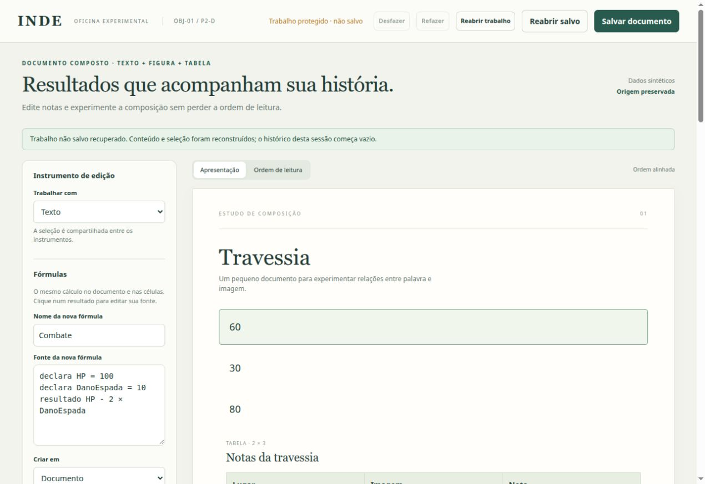

# OBJ-01 — Validação de Fórmula / P2-D

Data: 2026-11-21. Base `347be9d`. Implementação funcional `bb19da0`; guarda final de identidade persistida `53b534f`. Branch `feature/inde-obj-01-foundation`. Aprovação expressa do usuário para executar a proposta de Fórmula apresentada e discutida.

Ver [contrato e decisões](../arquitetura/FORMULAS-OBJ-01.md), [abrir a demonstração](../../tools/obj01-pilot/P2D.md) e [resultados estruturados](evidencias-obj01-p2d/resultados.json).



## Casos executados

| Caso | Evidência e alcance |
| --- | --- |
| F01 — fonte e resultado | Exemplo HP/DanoEspada → 80; fonte simples ou multilinha, chaves e `resultado final calcula`; caixa abre no próprio objeto e se recolhe ao aplicar |
| F02 — dependências | Outra fórmula consulta variável ou resultado; editar dano recalcula 70/35; referências ligadas por ID do objeto |
| F03 — documento/célula | Fórmula nasce em célula, alimenta documento e outra célula; o mesmo objeto pode ter usos nos dois lugares |
| F04 — mudança de estado | Executar reduz HP atual de 100 para 80, conserva inicial 100 e atualiza Combate/Metade/Bonus para 60/30/35 |
| F05 — atomicidade e histórico | Troca de valores lê mesmo estado anterior; alvo inválido, escrita duplicada e dependente dividido por zero recusam tudo; undo/redo/reset conservam fonte, valores e usos |
| F06 — execução definida | Criar, observar, mover, salvar e reabrir não executam atribuições; reinício não repete o golpe |
| F07 — erros editáveis | Fonte incompleta pode ser aplicada/salva/reaberta e reparada; ciclo e referência futura diagnosticados; nenhum resultado antigo é apresentado como válido |
| F08 — biblioteca e movimento | Mover/remover uso conserva objeto e dependentes; retirar fórmula de célula restaura texto simples anterior; undo restaura associação |
| F09 — persistência | SIGKILL recupera fontes, bindings, valores e células; falha pré-commit mantém estado; confirmação perdida pós-commit exige reabertura e reconstrói a cadeia |
| F10 — referências persistidas | Binding para outro ID/nome é recusado mesmo com hash externo recalculado; não há reinterpretação silenciosa |
| F11 — admissão | Nome duplicado/inválido, fonte excedida, contexto incorreto e revisão stale recusados; funções, profundidade e números inválidos recebem diagnóstico |
| F12 — preservação/publicação | Seed P2-C somente leitura conserva a ordem textual reordenada; demos A/B/C e origem congelada preservadas; publicação continua recusada na fronteira do piloto |

## Verificação técnica

- **19 testes P2-D do processo** e **sete HTTP reais**, incluindo quatro percursos comuns de token/origem/Host, admissão, importação/save/reabertura e interface. Um dos testes compara 40 expressões geradas com valores independentes.
- Regressões conservadas: P2-A 19 testes do processo + quatro HTTP; P2-B 12 + seis; P2-C 16 + sete; nove grupos da ponte documental.
- **Nove programas CTest aprovados em cada uma das quatro variantes finais**: GCC 15.2 e Clang 18.1, normais e com ASan+UBSan. LeakSanitizer local desativado; matriz remota o executa.
- Núcleo isolado e comandos: **2/2 programas locais aprovados**, após acrescentar Formula ao fim do enum sem alterar os valores dos tipos anteriores.
- Suíte nativa Release: **61/61 programas aprovados em 266,08 s**, sem alteração dos motores canônicos.
- Três pacotes originais reextraídos e conferidos por hash, manifesto e bytes; cinco testes do auditor aprovados.
- Sintaxe JavaScript/Python/iniciador, links locais, manifesto e `git diff --check` conferidos.

CI da implementação final `53b534fca2d20aa49f593676c71c998ba5fe6d4e`: [execução 44932366424](https://github.com/Roger-Cardoso/inde/actions/runs/44932366424), **25/25 jobs aprovados**, incluindo LeakSanitizer remoto. [Resultado bruto](evidencias-obj01-p2d/ci.json). A implementação funcional anterior também recebeu CI própria; o manifesto e os resultados deste relatório apontam para a guarda final. O commit documental recebe verificação separada.

## Demonstração observada

A demo nova `dados/obj01-piloto-p2d/` foi criada por cópia READONLY do salvo de P2-C. Foram criados no navegador Combate, Metade e Golpe no documento, e Bonus na última célula da tabela existente. Os resultados iniciais eram 80, 40, 100 e 45. O clique em Combate abriu sua fonte no próprio lugar; mudar dano para 15 e aplicar recolheu a fonte e atualizou Combate/Metade/Bonus para 70/35/40. A [captura da edição](evidencias-obj01-p2d/fonte-em-edicao.jpg) e o [estado acessível](evidencias-obj01-p2d/fonte-em-edicao.txt) registram esse percurso.

Depois de desfazer a edição, executar Golpe alterou o HP uma vez e atualizou os três resultados dependentes. Undo/redo restaurou a operação inteira. A biblioteca mostrou inicial 100 e atual 80; a fonte não foi reescrita para esconder essa diferença.

Sem usar Salvar, foi enviado SIGKILL exclusivamente ao processo C++ da nova demo. O servidor foi encerrado com SIGINT em seguida; a saída -9 do filho foi esperada nesse ensaio. Um novo processo reabriu a mesma pasta. Snapshot/hash/geração de trabalho e salvo eram iguais aos registrados antes da interrupção; o salvo continuava revisão 0. Fonte, bindings, substituições de valores e associações de célula foram conservados. O navegador mostrou 60/30/80/35, aviso de trabalho recuperado e histórico vazio. O golpe não foi executado novamente.

A observação visual cobre o núcleo funcional de `bb19da0`. Depois da guarda adicional de bindings em `53b534f`, o binário final reabriu uma cópia isolada e consistente dessa mesma demo, obtida por backup somente de leitura, e reproduziu os quatro resultados com todas as fórmulas válidas, salvo 0 e histórico vazio. A guarda nova também recebeu o teste negativo específico e a matriz completa. Assim se distinguem a revisão observada na interface e a verificação final do motor.

A [conferência do reinício](evidencias-obj01-p2d/reinicio.json), o [readback do binário final](evidencias-obj01-p2d/binario-final-readback.json), os resultados [antes](evidencias-obj01-p2d/resultados-antes.json)/[depois](evidencias-obj01-p2d/resultados-depois.json) e o [estado acessível final](evidencias-obj01-p2d/navegador-final.txt) acompanham o relatório. Integridade SQLite e chaves estrangeiras passaram.

## Falha encontrada e corrigida

Uma execução HTTP com Clang falhou ao ler o arquivo de prontidão: ele existia, mas ainda estava vazio. A publicação anterior criava o nome final antes de escrever o JSON completo. O [log inicial](evidencias-obj01-p2d/falha-inicial-prontidao.txt) foi preservado.

O servidor agora prepara um arquivo privado completo, sincroniza-o e publica seu nome por ligação atômica, sem sobrescrever arquivo existente. Os testes registram limpeza antes da espera de prontidão, para encerrar o processo mesmo quando setUp falha. Um processo órfão desse ensaio, com pasta temporária já removida, foi encerrado; nenhuma demo ou processo autoral foi afetado. Os nove programas finais passaram nas quatro variantes após a correção. Não se classificou a falha inicial como passe.

## Preservação e limites reais

`main` conserva HEAD `d41a5c9b9809ca7d40beb6ff10f22f1a5b451e0b` e apenas a mudança de modo preexistente em `Preparar-ponte.sh`. Demos P2-A/B/C permanecem byte a byte iguais à conferência inicial. Fontes compactadas, metadata, CMake do aplicativo e motores canônicos permanecem preservados. O núcleo isolado recebeu somente o novo tipo reconhecido; seus valores anteriores foram mantidos. O orçamento agregado passou a contar também cópia textual/contexto: registros anteriores próximos do limite podem ser recusados pela contagem completa, sem truncamento. As fixtures anteriores passaram na regressão. Não houve escrita em obras, migração real, merge em main, GTK, arquivo único `.inde` ou publicação autoral.

A implementação cobre cálculo numérico, seis funções, variáveis/referências, atribuições explícitas, uso compartilhado em células/documento, movimento/remoção, fonte editável, diagnóstico, histórico e recuperação. Tabelas da demo continuam 2 × 3, sem edição de linhas/colunas.

Permanecem fora: compatibilidade Excel/XLSX completa, referências A1 e intervalos, resultados textuais/datas, renomeação de símbolos, funções próprias, gatilhos automáticos e iteração, aritmética decimal exata, integração do publicador e renderização de Equação. Precisão, limites e linguagem estão explícitos no contrato/roteiro. Histórico não persiste após reinício. Texto ainda não aplicado/enviado ao núcleo não tem proteção garantida. Não houve ensaio de falta de energia/todos os erros físicos, ampla concorrência, todos os viewports ou benchmark de RSS/latência.

Aceite humano continua separado da demonstração técnica. A entrega não declara concluída a Fase 2 inteira nem inicia a Fase 3. Não há bloqueio externo para usar a demo; há capacidades posteriores explicitamente não implementadas.

## Conferência reproduzível

```sh
sha256sum -c docs/validacao/evidencias-obj01-p2d/SHA256SUMS
python3 verificar_base.py --integrado --extrair
cmake -S tests/object_composite_pilot -B build-obj01-p2a -G Ninja -DCMAKE_BUILD_TYPE=Debug
cmake --build build-obj01-p2a --parallel 2
ctest --test-dir build-obj01-p2a --output-on-failure
```

Os testes HTTP precisam de acesso a loopback. O [manifesto](evidencias-obj01-p2d/SHA256SUMS) usa caminhos relativos à raiz da worktree. Manifestos históricos com código/documentação mutáveis devem ser conferidos nos commits que os registraram; P2-C, P2-B e P2-A foram conferidos nas revisões correspondentes, sem reescrever suas evidências.
